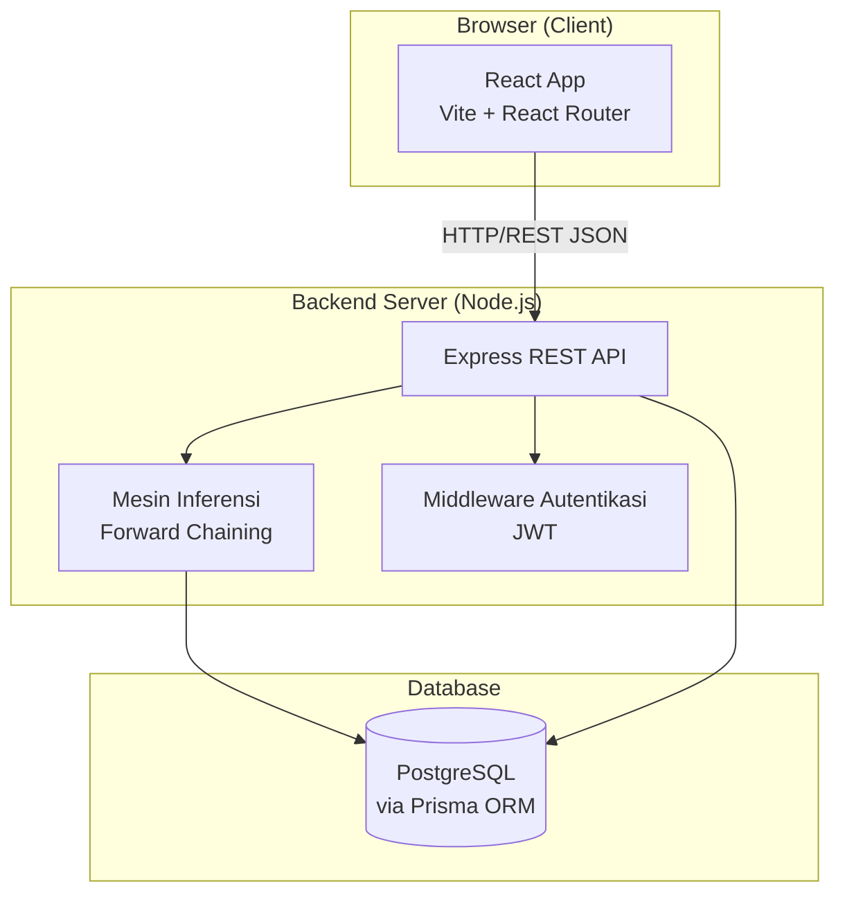
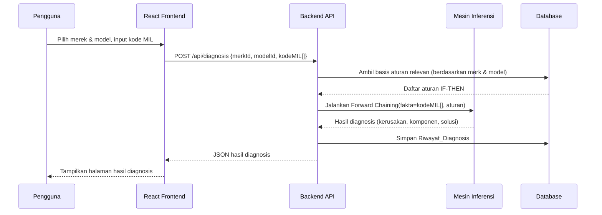

# Dokumen Desain Sistem

## Sistem Pakar Diagnosis Kerusakan Sepeda Motor Honda & Yamaha Berbasis Kode Kedipan MIL
**Objek:** Farhan Motor

---

## Ikhtisar

Sistem ini adalah aplikasi web full-stack yang mengimplementasikan sistem pakar untuk mendiagnosis kerusakan sepeda motor Honda dan Yamaha berdasarkan kode kedipan MIL (Malfunction Indicator Lamp). Metode inferensi yang digunakan adalah **Forward Chaining** — dimulai dari fakta yang diketahui (kode MIL yang diinput pengguna) kemudian dilacak ke depan melalui basis aturan untuk mencapai kesimpulan (diagnosis kerusakan).

Frontend dibangun dengan **React** (menggunakan Vite sebagai build tool), sedangkan backend menyediakan REST API untuk logika Forward Chaining dan manajemen data menggunakan **Node.js + Express**. Data disimpan di **PostgreSQL** dengan ORM **Prisma**.

---

## Arsitektur



### Alur Diagnosis (Forward Chaining)



---

## Komponen dan Antarmuka

### Frontend (React)

#### Struktur Halaman

| Halaman | Rute | Akses |
|---|---|---|
| Beranda | `/` | Publik |
| Panduan Penggunaan | `/panduan` | Publik |
| Form Diagnosis | `/diagnosis` | Publik |
| Hasil Diagnosis | `/diagnosis/hasil` | Publik |
| Login Admin | `/admin/login` | Publik |
| Dashboard Admin | `/admin/dashboard` | Autentikasi |
| Kelola Merek & Model | `/admin/master` | Autentikasi |
| Kelola Data Teknis | `/admin/data-teknis` | Autentikasi |
| Kelola Basis Aturan | `/admin/basis-aturan` | Autentikasi |
| Riwayat Diagnosis | `/admin/riwayat` | Autentikasi |
| Kelola Pengguna Admin | `/admin/pengguna` | Autentikasi |

#### Komponen Utama

- **`DiagnosisWizard`**: Komponen multi-langkah untuk alur diagnosis (pilih merek → pilih model → input kode MIL → proses → hasil).
- **`ForwardChainingLoader`**: Indikator loading saat proses inferensi berlangsung.
- **`HasilDiagnosis`**: Menampilkan hasil diagnosis, komponen, dan solusi.
- **`AdminLayout`**: Layout wrapper dengan sidebar navigasi untuk semua halaman admin.
- **`DataTable`**: Tabel data generik dengan fitur pencarian, filter, dan pagination.
- **`StatistikCard`** dan **`StatistikGrafik`**: Komponen visualisasi data untuk dashboard.
- **`AuthGuard`**: Higher-Order Component untuk proteksi rute admin.

### Backend API (Express)

#### Endpoint Publik

| Method | Endpoint | Deskripsi |
|---|---|---|
| GET | `/api/merek` | Daftar semua merek motor |
| GET | `/api/merek/:id/model` | Daftar model berdasarkan merek |
| POST | `/api/diagnosis` | Jalankan proses diagnosis |
| GET | `/api/panduan` | Data konten panduan |

#### Endpoint Admin (memerlukan JWT)

| Method | Endpoint | Deskripsi |
|---|---|---|
| POST | `/api/admin/login` | Autentikasi admin |
| POST | `/api/admin/logout` | Hapus sesi admin |
| GET | `/api/admin/dashboard/statistik` | Data statistik dashboard |
| GET/POST/PUT/DELETE | `/api/admin/merek` | CRUD merek motor |
| GET/POST/PUT/DELETE | `/api/admin/model` | CRUD model motor |
| GET/POST/PUT/DELETE | `/api/admin/kode-mil` | CRUD kode MIL |
| GET/POST/PUT/DELETE | `/api/admin/gejala` | CRUD gejala |
| GET/POST/PUT/DELETE | `/api/admin/kerusakan` | CRUD kerusakan |
| GET/POST/PUT/DELETE | `/api/admin/komponen` | CRUD komponen |
| GET/POST/PUT/DELETE | `/api/admin/solusi` | CRUD solusi |
| GET/POST/PUT/DELETE | `/api/admin/basis-aturan` | CRUD basis aturan |
| GET | `/api/admin/riwayat` | Daftar riwayat diagnosis |
| POST | `/api/admin/laporan/cetak` | Generate laporan PDF |
| GET/POST/PUT/DELETE | `/api/admin/pengguna` | CRUD akun admin |

---

## Model Data

### Skema Database (PostgreSQL via Prisma)

```prisma
model Merek {
  id       Int      @id @default(autoincrement())
  nama     String   @unique
  model    Model[]
  kodeMIL  KodeMIL[]
  createdAt DateTime @default(now())
  updatedAt DateTime @updatedAt
}

model Model {
  id        Int      @id @default(autoincrement())
  nama      String
  merekId   Int
  merek     Merek    @relation(fields: [merekId], references: [id])
  kodeMIL   KodeMIL[]
  diagnosis Diagnosis[]
  @@unique([nama, merekId])
}

model KodeMIL {
  id          Int       @id @default(autoincrement())
  kode        String
  deskripsi   String
  merekId     Int
  modelId     Int?
  merek       Merek     @relation(fields: [merekId], references: [id])
  model       Model?    @relation(fields: [modelId], references: [id])
  basisAturan BasisAturan[]
  @@unique([kode, merekId, modelId])
}

model Gejala {
  id          Int       @id @default(autoincrement())
  nama        String    @unique
  deskripsi   String?
  basisAturan BasisAturan[]
}

model Kerusakan {
  id          Int       @id @default(autoincrement())
  nama        String    @unique
  deskripsi   String?
  basisAturan BasisAturan[]
  komponen    KerusakanKomponen[]
  solusi      KerusakanSolusi[]
}

model Komponen {
  id        Int                 @id @default(autoincrement())
  nama      String              @unique
  deskripsi String?
  kerusakan KerusakanKomponen[]
}

model Solusi {
  id        Int               @id @default(autoincrement())
  langkah   String
  urutan    Int
  kerusakan KerusakanSolusi[]
}

model KerusakanKomponen {
  kerusakanId Int
  komponenId  Int
  kerusakan   Kerusakan @relation(fields: [kerusakanId], references: [id])
  komponen    Komponen  @relation(fields: [komponenId], references: [id])
  @@id([kerusakanId, komponenId])
}

model KerusakanSolusi {
  kerusakanId Int
  solusiId    Int
  kerusakan   Kerusakan @relation(fields: [kerusakanId], references: [id])
  solusi      Solusi    @relation(fields: [solusiId], references: [id])
  @@id([kerusakanId, solusiId])
}

model BasisAturan {
  id          Int       @id @default(autoincrement())
  kodeMILId   Int
  gejalaid    Int
  kerusakanId Int
  bobot       Float     @default(1.0)
  aktif       Boolean   @default(true)
  kodeMIL     KodeMIL   @relation(fields: [kodeMILId], references: [id])
  gejala      Gejala    @relation(fields: [gejalaid], references: [id])
  kerusakan   Kerusakan @relation(fields: [kerusakanId], references: [id])
}

model Diagnosis {
  id              Int      @id @default(autoincrement())
  modelId         Int
  model           Model    @relation(fields: [modelId], references: [id])
  kodeMILInput    String[]
  hasilDiagnosis  Json
  createdAt       DateTime @default(now())
}

model Admin {
  id           Int      @id @default(autoincrement())
  email        String   @unique
  passwordHash String
  nama         String
  createdAt    DateTime @default(now())
  updatedAt    DateTime @updatedAt
  loginAttempts Int     @default(0)
  lockedUntil  DateTime?
}
```

---

## Algoritma Forward Chaining

Algoritma ini diimplementasikan di sisi backend sebagai fungsi murni (pure function) yang menerima fakta dan basis aturan, lalu mengembalikan hasil diagnosis.

```
FUNCTION forwardChaining(faktaKodeMIL: string[], aturan: BasisAturan[]): HasilDiagnosis[]

  workingMemory = Set(faktaKodeMIL)   // inisialisasi memori kerja dengan fakta awal
  hasilAkhir    = Map<kerusakanId, HasilDiagnosis>
  agenda        = Queue(aturan yang kodeMILnya ada di workingMemory)

  WHILE agenda tidak kosong:
    aturanSaatIni = agenda.dequeue()

    IF aturanSaatIni.kodeMIL IN workingMemory AND aturanSaatIni.aktif:
      kerusakan = aturanSaatIni.kerusakan
      IF kerusakan belum ada di hasilAkhir:
        hasilAkhir[kerusakan.id] = {
          kerusakan, komponen, solusi, kodesMILPemicu: []
        }
      hasilAkhir[kerusakan.id].kodesMILPemicu.push(aturanSaatIni.kodeMIL)

  RETURN list(hasilAkhir.values()) diurutkan berdasarkan jumlah kodesMILPemicu DESC
```

**Keputusan Desain**: Algoritma diimplementasikan sebagai fungsi tanpa side effect agar mudah diuji secara unit dan property-based. Basis aturan diambil dari database sebelum fungsi dipanggil, sehingga fungsi dapat diuji sepenuhnya dalam isolasi tanpa mocking database.

---

## Properti Kebenaran (Correctness Properties)

*Sebuah properti adalah karakteristik atau perilaku yang harus berlaku di semua eksekusi sistem yang valid — pernyataan formal tentang apa yang seharusnya dilakukan sistem. Properti berfungsi sebagai jembatan antara spesifikasi yang dapat dibaca manusia dan jaminan kebenaran yang dapat diverifikasi secara otomatis.*

---

### Properti 1: Forward Chaining hanya menghasilkan kerusakan yang relevan

*Untuk setiap* kombinasi kode MIL dan basis aturan, semua kerusakan yang dikembalikan oleh mesin inferensi harus memiliki setidaknya satu aturan yang kode MIL-nya ada dalam input pengguna.

**Memvalidasi: Kebutuhan 5.3, 5.4**

---

### Properti 2: Kode MIL tanpa aturan menghasilkan hasil kosong

*Untuk setiap* kode MIL yang tidak memiliki aturan yang cocok dalam basis aturan yang diberikan, fungsi `forwardChaining` harus mengembalikan array kosong.

**Memvalidasi: Kebutuhan 5.5**

---

### Properti 3: Forward Chaining bersifat idempoten

*Untuk setiap* set kode MIL dan basis aturan yang sama, memanggil fungsi `forwardChaining` dua kali berturut-turut harus menghasilkan output yang identik.

**Memvalidasi: Kebutuhan 5.1, 5.3**

---

### Properti 4: Serialisasi hasil diagnosis bersifat round-trip

*Untuk setiap* objek `HasilDiagnosis` yang valid, melakukan serialisasi ke JSON kemudian deserialisasi harus menghasilkan objek yang setara secara struktural.

**Memvalidasi: Kebutuhan 5.6, 6.1**

---

### Properti 5: Validasi format kode MIL menolak semua input non-angka

*Untuk setiap* string yang mengandung karakter non-numerik atau berada di luar rentang yang didefinisikan, fungsi validasi kode MIL harus mengembalikan status tidak valid.

**Memvalidasi: Kebutuhan 4.3**

---

### Properti 6: Aturan yang dinonaktifkan tidak memengaruhi hasil

*Untuk setiap* basis aturan yang berisi aturan aktif dan non-aktif, mesin inferensi tidak boleh menghasilkan kerusakan yang hanya berasal dari aturan yang `aktif = false`.

**Memvalidasi: Kebutuhan 10.4**

---

### Properti 7: Pengurutan hasil berdasarkan jumlah pemicu

*Untuk setiap* hasil diagnosis dengan lebih dari satu kerusakan, kerusakan pertama dalam daftar harus memiliki jumlah `kodesMILPemicu` yang lebih besar atau sama dengan kerusakan berikutnya.

**Memvalidasi: Kebutuhan 6.3**

---

### Properti 8: Pembuatan hash kata sandi admin bersifat konsisten

*Untuk setiap* kata sandi plaintext yang diberikan, memverifikasi kata sandi tersebut terhadap hash yang dihasilkan harus selalu menghasilkan `true` (round-trip verifikasi bcrypt).

**Memvalidasi: Kebutuhan 9.5**

---

## Penanganan Kesalahan

| Skenario | Respons Backend | Tampilan Frontend |
|---|---|---|
| Kode MIL tidak ditemukan di basis aturan | `200 OK` dengan `hasil: []` | Pesan "Kode MIL tidak dikenali" + saran konsultasi teknisi |
| Merek/model tidak ditemukan | `404 Not Found` | Pesan error di form |
| Input kode MIL format tidak valid | `400 Bad Request` | Pesan error di field input |
| Kredensial admin salah | `401 Unauthorized` | Pesan "Email atau kata sandi salah" |
| Akun admin terkunci | `403 Forbidden` dengan sisa waktu kunci | Pesan informasi durasi kunci |
| Error server internal | `500 Internal Server Error` | Pesan generik "Terjadi kesalahan, coba lagi" |
| Token JWT kadaluarsa | `401 Unauthorized` | Redirect otomatis ke halaman login admin |

---

## Strategi Pengujian

### Pendekatan Pengujian Ganda

Sistem ini menggunakan dua pendekatan pengujian yang saling melengkapi:

- **Unit Test**: Memverifikasi contoh spesifik, kasus tepi, dan kondisi error.
- **Property-based Test**: Memverifikasi properti universal di seluruh input yang dihasilkan secara acak.

### Library yang Digunakan

- **Backend**: `vitest` (test runner) + `fast-check` (property-based testing)
- **Frontend**: `vitest` + `@testing-library/react` (unit/component testing)

### Konfigurasi Property-Based Test

- Setiap property test harus dijalankan minimal **100 iterasi**.
- Setiap test harus diberi tag komentar referensi:
  `// Feature: sistem-pakar-mil-motor, Property N: <teks properti>`

### Strategi Khusus per Komponen

| Komponen | Unit Test | Property Test |
|---|---|---|
| `forwardChaining()` | Contoh kode MIL tertentu, aturan kosong | Properti 1, 2, 3, 6, 7 |
| Validasi kode MIL | Input valid/invalid spesifik | Properti 5 |
| Serialisasi `HasilDiagnosis` | Contoh objek tertentu | Properti 4 |
| Hash kata sandi (`bcrypt`) | Kata sandi contoh | Properti 8 |
| Komponen React `DiagnosisWizard` | Alur navigasi wizard | - |
| Endpoint API `/api/diagnosis` | Request valid/invalid | - |

### Prioritas Pengujian

1. Fungsi `forwardChaining` (inti logika bisnis)
2. Validasi input kode MIL
3. Autentikasi dan otorisasi admin
4. Operasi CRUD data master dan teknis
